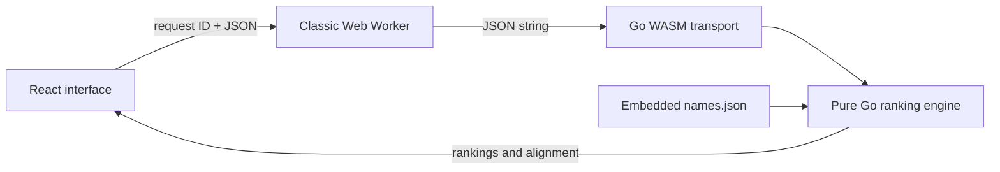

# Architecture and operation

The deliverable is `dist/`: static HTML, CSS, JavaScript, fonts, images, a WASM binary, and license notices. No application server or database is required. Vite's local server only serves files during review.



## Responsibilities

| Location | Responsibility |
|---|---|
| `engine/model.go` | Edit distance, alignment, scoring and homophone grouping |
| `engine/api.go` | Input validation and immutable JSON request/response API |
| `engine/names.json` | Checked-in processed data; no runtime downloads from data providers |
| `cmd/wasm/main.go` | Exposes `almostYou(json)` to JavaScript; no model logic |
| `public/worker.js` | Loads Go runtime and WASM; forwards requests and responses |
| `web/App.tsx` | Worker lifecycle, sequence IDs, forms, exploration and hash navigation |
| `web/NameInput.tsx` | Accessible inline suggestions; pointer selection retains input focus |
| `web/Tuning.tsx` | Collapsed formula-weight panel; commits on settled `change` events (250 ms debounce), flushes pending edits on model switch, and persists validated weights |
| `web/Theme.tsx` | Live system preference, fixed-theme toggle and local persistence |
| `web/Science.tsx` | Formulas, evidence, references and limits |
| `scripts/` | Build, notices, artifact checks, bridge verification and visual assets |

The main thread waits for the worker's catalog/readiness response. A 30-second startup timeout exposes a retry control. A monotonically increasing request ID prevents a superseded response from replacing newer state. The worker is terminated on teardown. Model data never mutates.

The name field uses an inline ARIA combobox instead of a native datalist. Suggestions appear above the field so the submit action remains reachable. Tap selection is handled on a stationary pointer release because WebKit can suppress click after preventing focus loss. An active option captures its pointer and survives input blur until the gesture finishes; canceled or moved gestures do not select. If the input lost focus during a successful tap, it is restored within that gesture without scrolling, with the pointer focus ring explicitly suppressed until keyboard interaction. Arrow keys, Enter and Escape work without moving focus away from the input. The badge stays upright while a control inside it is focused or suggestions are open, so a viewport-related blur cannot rotate the release target away from a finger.

The theme controls follow the reference site: a light/dark toggle opts into a fixed preference; a monitor button restores live system following and indicates its active state. Icons are inline SVG to avoid platform emoji substitutions.

Two engine actions exist: `catalog` returns supported spellings and model metadata; `rank` accepts `name`, `n` (1–20), `mode` (`sound` or `frequency`), `variant` (zero-based target pronunciation), optional `compare`, and optional `weights` (`sound`, `edge`, `frequency`, `last`, each 0–100). Sound, edge and frequency weights are relative and divided by their sum; `last` is the percentage of E given to the final sound. The sound model rejects a nonzero frequency weight, and an all-zero sum is rejected. Responses echo the normalized `weights` and a `custom` flag; omitting `weights` is identical to sending the mode defaults. The UI offers 5, 10 or 20 results. Errors return readable JSON rather than throwing across the transport boundary.

The explorer lives at `#explore`; science and its section anchors are hash views of the same document. Name input never enters the URL. Data is lost on reload. Only `almost-you-theme` and `almost-you-weights` are stored locally, and storage failures are harmless. The weights record is `{v: 1, sound: {…}, frequency: {…}}`. It is written when a slider change settles and when Restore defaults is used (which writes the defaults explicitly). Malformed, out-of-range, all-zero or sound-model-frequency values fall back per model to defaults. Citation links leave the site only when explicitly followed.

## Build and review

Node 22.12+ and Go 1.25+ are required. The lockfile pins JS dependencies. No Go dependencies are needed. `npm run build` compiles the embedded engine, copies the Go browser runtime/license, bundles local fonts, writes dependency notices, typechecks and verifies distribution artifacts.

```sh
npm ci
npm test
npm run build
npm run preview -- --port 5173 --strictPort
```

Open `http://127.0.0.1:5173`. For a phone on the same trusted network, use `npm run preview:lan -- --port 5173 --strictPort`; the development-only SSL plugin supplies a self-signed certificate. The browser may require accepting that local certificate. Neither preview mode sends name input to the server. Stop the foreground server with Ctrl+C.

`npm run dev` rebuilds WASM once and starts Vite. Restart it after changing Go or data. `npm run test:browser` owns localhost port 4187 and tests the built site with the production CSP. `npx playwright install chromium webkit` installs browsers when missing. Screenshot and share-card scripts use separate ports 4192 and 4191 and close them on completion.

The policy permits only same-origin static resources and WASM execution. It denies embedded objects and form submissions; forms are handled in React. CloudFront sends the same policy as an HTTP header (configured in `iwvelando/cloud-accounts`, `sites/almost-you.isaacvelando.com`), which is what enforces `frame-ancestors`; a meta tag cannot. The deploy job fails if the live header differs from this file. `img-src` allows `data:` only for the stylesheet's select chevron. `style-src-attr 'unsafe-inline'` is there because WebKit reports a violation for native `<select>` controls without it; stylesheets and scripts stay same-origin. `tests/smoke.spec.ts` fails on any reported violation. There is no service worker: after loading, exploration needs no requests, but a fresh offline visit is not guaranteed.

## Rebuilding data

Ordinary builds use committed `engine/names.json` and require no network. To update data intentionally, retrieve the two source files named in `data/provenance.json` into `work/source-data/cmudict.dict` and `work/source-data/ssa-alldata.txt`, then run `node scripts/build-data.mjs`. The current pipeline explicitly selects 1950–2020 and a 500-count minimum. Source URLs use moving branches; existing SHA-256 values identify this snapshot. Preserve the committed derived file for exact reproduction, or obtain matching raw snapshots and verify their hashes. Regeneration with changed upstream bytes is a dataset update, not a reproducible rebuild.

Update the retrieval date, source hashes, coverage count, scientific copy and tests together. Inspect data errors before widening scope or adding pronunciation overrides. Do not silently guess missing pronunciations. The SSA official download returned HTTP 403 during preparation, so the documented public mirror was used; it ends in 2020. No claim is made that this is the latest SSA release.

## Costs and limits

Go WASM adds a few megabytes before compression and a startup delay. The separate worker keeps distance calculations off the rendering thread. This matches the reference project's architecture; CloudFront serves the engine compressed, and a later performance pass could benchmark an equivalent TypeScript implementation. The baseline is not a neural simulation or a trained model.
